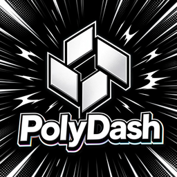
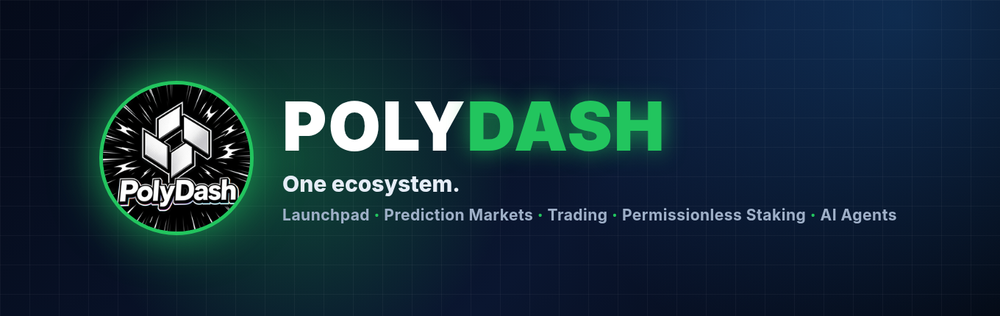
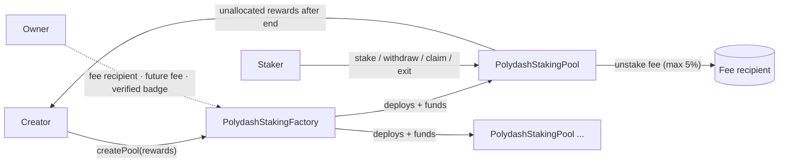

<p align="center">
  
</p>

<h1 align="center">Polydash</h1>

<p align="center">
  Open-source DeFi infrastructure on Robinhood Chain: permissionless staking pools, the Polypad launchpad and on-chain AI agents.
</p>

<p align="center">
  <a href="https://github.com/PolydashDev/Polydash/actions/workflows/ci.yml"></a>
  <a href="LICENSE"></a>
  
  <a href="https://getfoundry.sh"></a>
</p>

<p align="center">
  <a href="https://dasheco.xyz">Website</a> ·
  <a href="https://polypad.abacusai.app">Polypad</a> ·
  <a href="https://x.com/Polydash_">X @Polydash_</a> ·
  <a href="https://t.me/defidashofficial">Telegram</a>
</p>

<p align="center"></p>

## Staking contracts

| Contract | Path | Description |
| --- | --- | --- |
| **PolydashStakingFactory** | [`src/PolydashStakingFactory.sol`](src/PolydashStakingFactory.sol) | Anyone can deploy a reward pool for any ERC-20 by depositing the rewards up front. The owner can only set the fee recipient, the unstake fee for *future* pools (hard-capped at 5%) and a "verified" badge. The owner can never touch pool funds. |
| **PolydashStakingPool** | [`src/PolydashStakingPool.sol`](src/PolydashStakingPool.sol) | One pool per campaign. Rewards stream linearly from `startTime` to `endTime`, shared pro-rata (Synthetix StakingRewards model). Stake / withdraw / claim / exit / emergencyWithdraw; the creator recovers unallocated rewards after the end. Fee-on-transfer tokens are credited by amount received. |
| **PolydashStakingFactoryV2** | [`src/v2/PolydashStakingFactoryV2.sol`](src/v2/PolydashStakingFactoryV2.sol) | Deployed V2 factory (recommended for new pools). Creator-chosen claim fee of 1-5% taken from rewards, 30% of it to the platform. The owner can only set the fee recipient and the verified badge. |
| **PolydashStakingPoolV2** | [`src/v2/PolydashStakingPoolV2.sol`](src/v2/PolydashStakingPoolV2.sol) | Deployed V2 pool. 1e36-scaled reward accumulator with a carried division remainder; principal never charged a fee; fees accrue in the pool and are collected separately. |

## Deployments: Robinhood Chain (chain ID 4663)

| Contract | Address | Source |
| --- | --- | --- |
| StakingFactory v1 (legacy) | [`0x0aAEa47d2e7303EC5a809062eafa59e7F011D857`](https://robinhoodchain.blockscout.com/address/0x0aAEa47d2e7303EC5a809062eafa59e7F011D857) | In this repo: [`src/`](src). Legacy: do not use for 6-decimal reward tokens (see warning below). Not yet verified on the explorer (see note below). |
| StakingFactory v2 | [`0x904b8F5d95B593b5F4a6Dbb116b58e1d5CBe93f0`](https://robinhoodchain.blockscout.com/address/0x904b8F5d95B593b5F4a6Dbb116b58e1d5CBe93f0) | **Verified** (exact match, `PolydashStakingFactoryV2` + `PolydashStakingPoolV2`, solc 0.8.24): [Blockscout](https://robinhoodchain.blockscout.com/address/0x904b8F5d95B593b5F4a6Dbb116b58e1d5CBe93f0?tab=contract) · [Sourcify](https://repo.sourcify.dev/4663/0x904b8F5d95B593b5F4a6Dbb116b58e1d5CBe93f0). Deployed Oct 8 2026, 3 pools. Pools are deployed by the factory from the verified `PolydashStakingPoolV2` source and are not individually verified on the explorer yet. Source mirrored in [`src/v2/`](src/v2) with a runtime bytecode check against the factory and pools ([details](src/v2/README.md)). |
| Polypad PolydashFactory (current) | [`0xfDfD0A095966c8B56639f7eAa13f4B0188Fc08c2`](https://robinhoodchain.blockscout.com/address/0xfDfD0A095966c8B56639f7eAa13f4B0188Fc08c2) | Current launch factory. Verified on [Sourcify](https://sourcify.dev/server/v2/contract/4663/0xfDfD0A095966c8B56639f7eAa13f4B0188Fc08c2) (match). Permissionless `createLaunch`, see [docs/AGENTS_LAUNCH.md](docs/AGENTS_LAUNCH.md). |
| Polypad PolydashFactory (legacy) | [`0x2c84cfcd8d283ef750e09fbed735d67f67845db2`](https://robinhoodchain.blockscout.com/address/0x2c84cfcd8d283ef750e09fbed735d67f67845db2) | Earlier launch factory; its launches stay live. Verified on [Sourcify](https://repo.sourcify.dev/4663/0x2c84cfcd8d283ef750e09fbed735d67f67845db2) (match). Source and ABIs in [`polypad/`](polypad). |
| Polypad PolydashLaunch | [`0xef7684268f13bc06cb02755642ceabef422b8b70`](https://robinhoodchain.blockscout.com/address/0xef7684268f13bc06cb02755642ceabef422b8b70) | Launch implementation (EIP-1167 clones). Verified on [Sourcify](https://repo.sourcify.dev/4663/0xef7684268f13bc06cb02755642ceabef422b8b70) (match). Source and ABIs in [`polypad/`](polypad). |
| Polypad PolydashHook | [`0x04990e6671c98e1b43034e52366af11396d960cc`](https://robinhoodchain.blockscout.com/address/0x04990e6671c98e1b43034e52366af11396d960cc) | Uniswap V4 hook used after graduation. Verified on [Sourcify](https://repo.sourcify.dev/4663/0x04990e6671c98e1b43034e52366af11396d960cc) (match). Source and ABIs in [`polypad/`](polypad). |
| Polypad PolydashCommitVault | [`0x8f125c9ec7acd52b9cd39f2a7441085559d84104`](https://robinhoodchain.blockscout.com/address/0x8f125c9ec7acd52b9cd39f2a7441085559d84104) | Commitment-window vault. Verified on [Sourcify](https://repo.sourcify.dev/4663/0x8f125c9ec7acd52b9cd39f2a7441085559d84104) (match). Source and ABIs in [`polypad/`](polypad). |
| $POLYDASH token | [`0x319525528f42167eF7fC18b77b889958080568e4`](https://robinhoodchain.blockscout.com/address/0x319525528f42167eF7fC18b77b889958080568e4) | Deployed via Clanker, not in this repo. LP locked. |

> **Warning: v1 is legacy.** The v1 factory's reward accumulator uses 1e18 precision. With a 6-decimal reward token (such as USDC) and a large 18-decimal stake supply, each update can round to zero and those rewards are lost. Do not create v1 pools with 6-decimal reward tokens; new pools should use StakingFactory v2, which keeps rewards at 1e36 precision with a carried remainder (see [`src/v2/README.md`](src/v2/README.md)).

Compiler settings: `solc 0.8.24`, optimizer 200 runs, `via_ir = true`, EVM `paris`.

The v1 runtime bytecode built from `src/` is identical to the deployed factory except for the trailing CBOR metadata hash (source paths moved from `contracts/` to `src/`). For explorer verification, submit the sources under their original `contracts/` paths.

## Architecture



See [docs/ARCHITECTURE.md](docs/ARCHITECTURE.md) and [docs/AUDIT_SCOPE.md](docs/AUDIT_SCOPE.md).

## The Polydash ecosystem

| Product | What it does |
| --- | --- |
| **Polypad** | Token launchpad on Robinhood Chain. Projects go through [@bevourAI](https://x.com/bevourAI) pre-launch checks and must have a doxxed lead. Includes automated staking and AI agents built on the [@swarmsAI](https://x.com/swarmsAI) stack. Contract addresses and ABIs in [polypad](polypad). |
| **Polypredict** | Prediction markets inside Telegram. |
| **Polytrade** | AI-assisted trading. |
| **Staking-as-a-Service** | Permissionless, automated staking pools for any ERC-20. **This repository.** |
| **Poly Agent** | AI staking analyst for Polypad pools: live APRs and inflow/outflow alerts. Code in [agents/poly-agent](agents/poly-agent). [Live on the Swarms marketplace](https://swarms.world/agent/fbd6fcd5-8187-4bc7-98b2-59c9fc93a271). |
| **PolyCTO** | The AI CTO assigned to every Polypad launch: Telegram community manager, marketing expert, token analyst and smart contract security scanner. Code in [agents/polycto](agents/polycto). [Live on the Swarms marketplace](https://swarms.world/agent/645381f2-f41d-4220-9ea3-3d05932ef0bc). |

## Repository layout

```
├── src/                     # Production contracts (v1; runtime code matches deployment)
├── test/                    # Foundry unit + fuzz tests, mocks/
├── script/Deploy.s.sol      # Env-driven deployment script
├── polypad/                 # Polypad launchpad: contracts, ABIs, deployments, web app
├── agents/poly-agent/       # Poly Agent (Swarms marketplace agent)
├── agents/polycto/          # PolyCTO (Swarms marketplace agent)
├── docs/                    # Architecture & audit scope
├── assets/                  # Logo and banner
├── lib/                     # openzeppelin-contracts v5.0.2, forge-std (submodules)
└── .github/                 # CI, issue & PR templates
```

## Quickstart

```bash
git clone --recursive https://github.com/PolydashDev/Polydash.git
cd Polydash
forge build
forge test
forge coverage --ir-minimum --no-match-coverage "test|script"
```

### Deploy

```bash
cp .env.example .env   # fill in locally, never commit
source .env
forge script script/Deploy.s.sol --rpc-url robinhood --broadcast
```

Prefer a hardware wallet or encrypted keystore (`--account`) over a raw `PRIVATE_KEY` for mainnet.

## Security

Please report vulnerabilities privately; see [SECURITY.md](SECURITY.md).
Staking involves smart-contract risk. Nothing in this repository is financial advice or a promise of returns.

## History

Polydash was previously known as Defidash. The community Telegram keeps its original handle.

## License

[MIT](LICENSE) © 2026 Polydash
